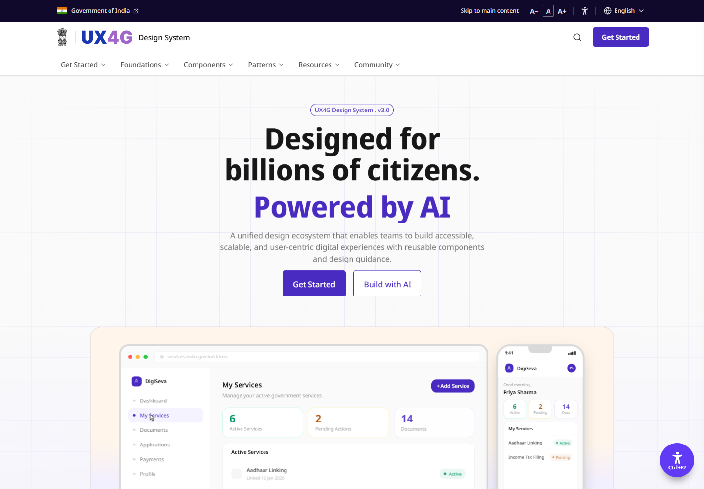
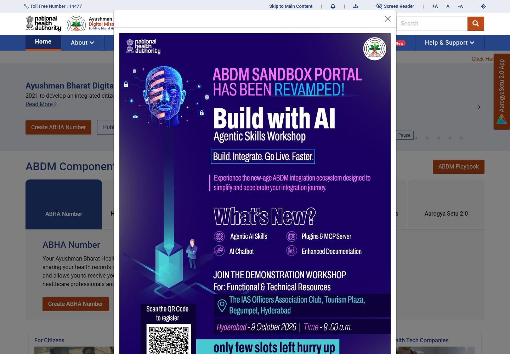
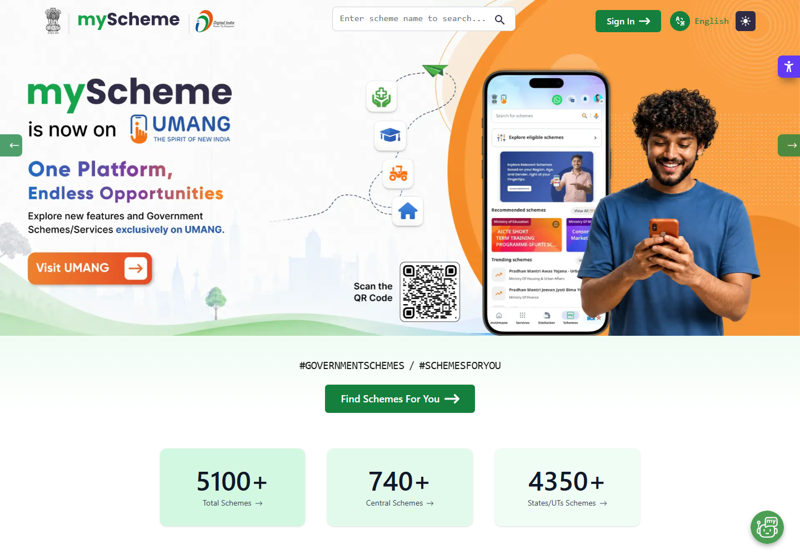

# Government portal design research

Checked 8 October 2026. Five public portals were loaded with a **headless Chrome browser** at 1440×1000. myScheme and eMitra were additionally captured at 390×844. These are first-viewport observations, not a complete usability/accessibility audit.

Capture URLs, title, HTTP status, time and extracted visible text are recorded in [capture metadata](reference-captures/capture-metadata.json). All five returned HTTP 200; that does not establish all assets/API calls worked. Transient overlays/render failures are noted rather than hidden.

## 1. Reference matrix

| Portal / official source | Observed in capture | Adopt in ASHA Saath | Scope/limitation |
|---|---|---|---|
| [UX4G](https://www.ux4g.gov.in/) | Dark utility strip, skip link, type/language controls, white identity row and horizontal navigation; page identifies Design System 3.0 | Clear information hierarchy, accessibility controls and consistent components | Its current purple brand is not a mandatory government palette; do not copy marketing slogans |
| [ABDM/NHA](https://abdm.gov.in/) | Utility/help strip, identity/search row, blue navigation, orange active accent and service cards | Formal shell and restrained navigation accent | Initial promotional modal obscured much content; not evidence about authenticated health workflows |
| [myScheme](https://www.myscheme.gov.in/) | Search/language/sign-in in header, green actions, large scheme-finder CTA and statistic panels | Explicit service search, language choice and clear action hierarchy | Scheme statistics are not our data. The 390-pixel capture has a compressed hero/header |
| [Rajasthan eMitra](https://emitra.rajasthan.gov.in/) | Blue utility/navigation bar, identity zone, large service tiles and status/help sections | Citizen-service grouping, clear help and status language | Initial modal contains an asset that did not render in this session; mobile viewport shows clipping. Do not generalize to every user |
| [NPO Darpan](https://ngodarpan.gov.in/) | Identity/language/type controls, India visual, category filter and counters | Geographic discovery and separated organization information | Initial capture had a dim overlay/empty alert and partly unfilled text/counters. Content reliability not established from this view |

## 2. Visual evidence

These reference screenshots show the current public page and may contain government/vendor marks. They are research evidence, **not product branding assets**.

### UX4G current public shell

### ABDM public shell with its initial overlay

### myScheme service discovery

Mobile reference: [myScheme mobile](reference-captures/myscheme-mobile.png). Other captures: [eMitra desktop](reference-captures/emitra-desktop.png), [eMitra mobile](reference-captures/emitra-mobile.png), [Darpan desktop](reference-captures/darpan-desktop.png).

## 3. Standards and current-source findings

The [GIGW 3.0 scope](https://guidelines.india.gov.in/scope-and-objective/) connects government website/app usability, accessibility and security guidance with WCAG 2.1 and related Indian standards/law. Reading or adopting patterns does not certify a product.

[UX4G foundations](https://www.ux4g.gov.in/foundations?lang=en) describes foundations including colour, typography and a base-four spacing approach. Its [component catalogue](https://www.ux4g.gov.in/components) provides form, navigation and feedback patterns. The public home currently labels v3.0, while some documentation snippets still reference older packages. Check the actual version/package API before installing; do not mix an older global CSS CDN with a new Lovable scaffold.

Our implementation targets [WCAG 2.2](https://www.w3.org/TR/WCAG22/) AA, going beyond GIGW's documented WCAG 2.1 reference. Normal text contrast is at least 4.5:1; large text has a 3:1 threshold; relevant non-text indicators require contrast too. WCAG 2.2 target-size minimum is 24 CSS pixels with defined exceptions; **44–48 pixels is our stronger field-usability choice**, not the same AA rule. [W3C target-size guidance](https://www.w3.org/WAI/WCAG22/Understanding/target-size-minimum.html).

## 4. Product design decisions

| Decision | Why | Provenance |
|---|---|---|
| Dark navy utility strip + white identity header | Gives formal public-service character and hierarchy | Informed by observed UX4G/ABDM shells |
| Navy navigation + narrow saffron active accent | Familiar civic style; restrained in operational pages | Product-selected palette; no official required hex claim |
| White panels, slate text, subtle borders, modest radius | Clear tables/forms and printable information | Product proposal |
| Original ASHA Saath wordmark; synthetic banner | Honest ownership and capability status | Product requirement |
| Worker action list before route illustration | A phone user needs stop/next action, not a heavy map | Workflow proposal, not a field-tested finding |
| Hindi default for worker demo, English default for coordinator | Demonstrates assisted rural use and reviewer clarity | Product proposal; validate with actual users |
| Text + icon + colour for every status | Works without colour perception or tiny legends | Accessibility requirement |
| Persistent help and last-sync/source timestamps | Service recovery and data freshness are visible | Product operational requirement |
| No automatic carousel or on-load promotional modal | Protects the core task and reduces interruption | Product choice; captures showed overlays |

## 5. Things still needing user validation

No ASHA interviews, task timings or field accessibility tests were conducted in this design pass. Validate Hindi vocabulary, hand dominance/phone use, shared devices, literacy, coordinator table density and consent comprehension with local participants before a pilot.

Government style means structure, legibility and service accountability. It does not establish trustworthiness by itself; verified service metadata and truthful outcomes must do that.
