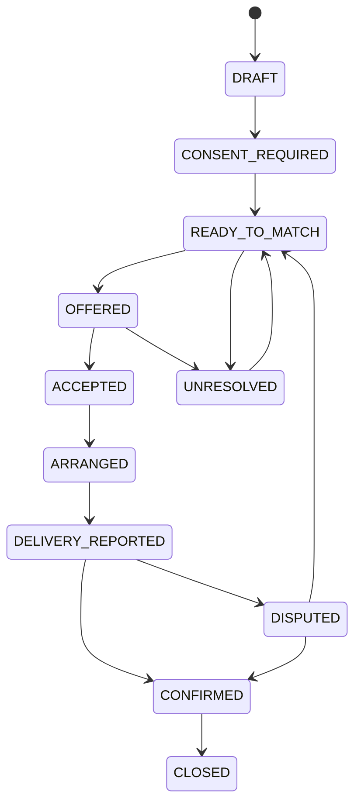

# Canonical state machines

Version 1.0. Store these enum names in code/database; translate only the display labels.

## 1. Visit/task states

| State | Meaning | Permitted next states |
|---|---|---|
| PENDING | Active task not committed to a daily plan | PLANNED, DEFERRED, ESCALATION_REQUIRED, CANCELLED |
| PLANNED | Included in a saved authorized plan | COMPLETED, NOT_AVAILABLE, DEFERRED, ESCALATION_REQUIRED, CANCELLED |
| COMPLETED | Authorized visit result recorded | No routine reversal; authorized correction event only |
| NOT_AVAILABLE | Household unavailable; task still requires review/replan | PENDING, PLANNED, DEFERRED, ESCALATION_REQUIRED |
| DEFERRED | Visit postponed with an explicit reason | PENDING, PLANNED, ESCALATION_REQUIRED, CANCELLED |
| ESCALATION_REQUIRED | Approved urgent clinical pathway needs health-team disposition | Authorized PENDING/COMPLETED/CANCELLED only after disposition |
| CANCELLED | Authorized cancellation with reason | No routine transition |

A planning preview/forecast never changes task states. Saved daily plans have their own version; a task's plan membership is represented by plan_stops. Clinical correction is append-only history with permission and reason, not deleting the original result.

## 2. Support-need states

**WITHDRAWN can be reached from any active state when permission is withdrawn.** CLOSED and WITHDRAWN are final business states; a later new need is a linked new record with new consent. After closure, privacy withdrawal still revokes access/marks consent without rewriting the completed event history.

| State | Owner / next action | Guard |
|---|---|---|
| DRAFT | Worker finishes minimal capture | Assigned visit/catchment relationship |
| CONSENT_REQUIRED | Worker/person reviews fields and recipient | No external sharing |
| READY_TO_MATCH | Coordinator evaluates public/participating options | Current required consent |
| OFFERED | Named provider responds; coordinator tracks expiry | One active attempt |
| ACCEPTED | Provider/coordinator agree arrangement | Atomic capacity reservation |
| ARRANGED | Provider supplies help | Permitted appointment/method |
| DELIVERY_REPORTED | Worker/coordinator obtains recipient confirmation | Provider claim recorded separately |
| CONFIRMED | Coordinator closes service-specific need | Positive authorized confirmation |
| CLOSED | Completed support record under retention policy | Never implies clinical completion/benefit approval |
| UNRESOLVED | Coordinator identifies alternative/next action | Reason + next action + owner required |
| DISPUTED | Coordinator resolves disagreement | No success count until positive resolution |
| WITHDRAWN | Stop sharing; reconcile resources if necessary | Current consent/access revoked |

## 3. Referral-attempt states

One need may have many sequential attempts, at most one active. Active: **OFFERED, ACCEPTED, ARRANGED, DELIVERY_REPORTED, CONFIRMED, DISPUTED**. Closed attempt history remains read-only to ordinary actors.

| From | Command | To | Important effect |
|---|---|---|---|
| — | offer | OFFERED | Need OFFERED; sharing authorization scoped to recipient |
| OFFERED | accept | ACCEPTED | Capacity reserved atomically |
| OFFERED | decline | DECLINED | Need UNRESOLVED; no allocation |
| OFFERED | expire | EXPIRED | Need UNRESOLVED; provider access/actions revoked |
| ACCEPTED | arrange | ARRANGED | Appointment/method recorded |
| ARRANGED | report-delivered | DELIVERY_REPORTED | Keep reservation held pending confirmation |
| DELIVERY_REPORTED | confirm-received | CONFIRMED | Need CONFIRMED; reservation COMMITTED |
| DELIVERY_REPORTED | dispute | DISPUTED | Need DISPUTED; resource held for reconciliation |
| CONFIRMED | close | CLOSED | Need CLOSED; committed consumption retained |
| ACCEPTED/ARRANGED | cancel/timeout | CANCELLED/EXPIRED | Need UNRESOLVED; release unused reservation |
| Active | withdraw | CANCELLED | Need WITHDRAWN, access revoked; allocation handling depends on delivery stage |
| DISPUTED | resolve-received | CONFIRMED | Authorized evidence/confirmation; commit resource |
| DISPUTED | resolve-not-received | CANCELLED | Need UNRESOLVED; resource reconciled before release/re-offer |

Timeout after acceptance requires a documented agreement/deadline and coordinator policy. It is not the same as offered acceptance TTL. Do not auto-expire a reported delivery and reuse its slot.

## 4. Capacity reservation states

| State | Counts against free capacity? | Transition |
|---|---|---|
| RESERVED | Yes | Created on acceptance |
| COMMITTED | Yes, consumed | Positive service confirmation |
| RELEASED | No | Cancel before supply / verified unused resource |
| EXPIRED | No | Unused reservation timeout after guarded checks |
| RECONCILIATION_REQUIRED | Yes | Dispute or withdrawal after reported supply |

Free units = total_units − RESERVED − COMMITTED − RECONCILIATION_REQUIRED units.

On withdrawal **before** delivery, release unused reservation. On withdrawal **after** reported supply, revoke access immediately, hold for coordinator reconciliation and do not fabricate resource availability. Audit/resource reconciliation does not restore permission to contact or process the person.

## 5. Consent states

ACTIVE → WITHDRAWN or EXPIRED. A new purpose/recipient/field set creates a new consent version, not editing past consent text. Missing consent means no offer. Person/family decision and worker recording actor are distinct fields.

## 6. Funding/in-kind states

REQUESTED → REVIEWED → APPROVED → FULFILLMENT_RECORDED → RECONCILED.

REVIEWED may become DECLINED; pre-fulfillment states may become CANCELLED. “Approved” is not disbursed or supplied. External receipts/resources are reconciled; application never takes custody of money in the MVP.

The sequence above is the older proposed in-kind model. The user-authorized cash demo uses REQUESTED → APPROVED → PAYMENT_REPORTED → RECEIVED → CLOSED, plus decline, dispute, withdrawal and cancellation. Its exact guards, external reconciliation and actual command names are in [funding and communication](FUNDING_AND_COMMUNICATION.md). NGO approval cannot change a clinical task's priority. No application money custody is involved.

## 7. Guard and audit requirements

Every command checks authenticated relationship, tenant, current consent, entity version, valid predecessor state and idempotency. Persist actor/time/from/to/reason. Unknown transition returns INVALID_TRANSITION; no optimistic client-only state change is authoritative.
