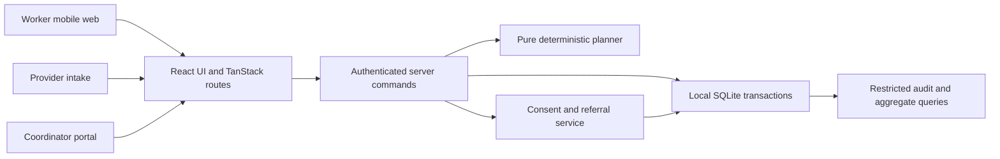

# Technical requirements — ASHA Saath

Version 1.3 · 8 October 2026. The generated app has been inspected and imported. The current local implementation is TanStack Start / React / TypeScript plus a Node 24 HTTP/SQLite backend; see [build status](BUILD_STATUS.md) for tested behaviour. PostgreSQL/RLS, offline and production architecture below remain deployment requirements, not implemented integrations.

## 1. Platform and build decision

Use a **new Lovable TanStack Start / React / TypeScript application**, retaining the generated routing, build configuration, lockfile and platform integration. Lovable's current FAQ identifies TanStack Start as the default for new apps since May 2026; an actual older project may still use React/Vite. Inspect the project's package manifest before choosing filenames. [Lovable stack](https://docs.lovable.dev/introduction/faq), [migration documentation](https://docs.lovable.dev/features/upgrade-to-tanstack-start).

Use the generated styling/component setup if it supports the tokens; Tailwind and accessible component primitives are the preferred implementation convention, not a claim about a scaffold that has not been created. Do not add Bootstrap/UX4G CDN globally over an existing utility/component system. UX4G pattern guidance is useful; the exact installed package/API version needs a fresh check.

The current local application uses one authoritative adapter: **Node HTTP commands with persistent SQLite**. Supabase was provisioned remotely but is unconnected. A future reviewed deployment may replace this adapter with PostgreSQL/Lovable Cloud/Supabase; the PostgreSQL schema/RLS sections describe that target. Do not write the same records to both backends or claim RLS based on local SQLite tests.

A current [Lovable terms](https://lovable.dev/terms) restriction on sensitive data means this build uses synthetic tasks only. A live health-data deployment is a separate reviewed implementation/contract decision.

## 2. Logical architecture

The diagram represents the working local adapter. Offline queues and PostgreSQL/RLS are future work. The planner works on an authorized input snapshot without network/LLM dependencies. Referrals use server commands and database transactions. Public programme cards are dated content, not live eligibility integrations.

## 3. Module boundaries

The current [funding/communication extension](FUNDING_AND_COMMUNICATION.md) adds server budget reservation, recipient-specific funding grants and persistent case messages. It shares existing SQLite transactions, authorization, no-store projections and idempotency. It has no money-transfer adapter and never alters the scheduling policy.

| Module | Owns | Must not own |
|---|---|---|
| Routes/shell | Role landing, navigation, loaders and redirects | Clinical rule calculation or service-role secrets |
| Planning domain | Input validation, tiering, locality groups, travel model, feasible plan, projection | Provider status or donation influence |
| Visits | Result recording and plan progress | Automatic NGO or clinical completion |
| Support domain | Need, consent, catchment filter, attempt transitions and recovery | Government benefit approval |
| Provider service | Scoped offered cases, capacities and delivery evidence | District-wide task records |
| Coordinator service | Verification, recovery queue, rule governance and closure | Unrestricted access by title alone |
| Repositories | Typed persistence and transaction adapters | UI labels or user permissions decided client-side |
| Offline client | Downloaded synthetic plan and retryable local commands | Live reservation/acceptance |
| Reporting | Cohort-safe counts and permitted geography aggregates | Sensitive logs or public household maps |

## 4. Import contract

Required demo columns: `source_dataset_id,source_task_id,patient_id,staff_id,locality_id,latitude,longitude,location_confidence,rule_id,rule_version,priority,due_date,earliest_time,latest_time,visit_minutes,required_cadre,defer_count,risk_flags,status,synthetic`.

This is an extended product contract; not every column is a verbatim organizer requirement. Accept documented aliases such as task_id → source_task_id only in preview.

Identity is `(source_dataset_id, source_task_id)`, scoped to tenant. Validate:

- Missing/duplicate IDs, patient with several legitimate tasks, conflicting repeat edits, unknown staff/rule/cadre and priority.
- Coordinates in range, location confidence, confirmed locality, parseable dates/time zone, earliest ≤ latest and positive finite duration.
- Rule/priority discrepancy, supplied flags with provenance and unknown classifications.
- Repeat import of unchanged rows yields no duplicate; changed clinical fields require explicit review/versioning.
- Import preview reports valid/error/review/excluded counts and row-specific reasons. Commit is atomic for the approved preview; rejected rows remain in the import report.

Default demo limits: 200 rows / 1 MB per upload, configurable; 24 rows in the supplied fixture. Limits are product choices. Sanitize exported CSV fields beginning with formula characters. Parse as text; never execute uploaded content.

## 5. Planning model

### Inputs

Worker ID, planning date, start/end coordinate, mode/speed, shift start/end, fixed break/commitments, safety buffer, authorized task snapshot, approved rule version and location uncertainty. Timestamps persist in UTC; visit dates/local windows use **Asia/Kolkata**. Demo clock is frozen and clearly displayed.

Do not infer priority from symptoms, an LLM, incentives or funding. P1/P2/P3 are synthetic/approved input classes; urgent escalation is separate.

### Deterministic algorithm

1. Partition: completed/cancelled, clinical escalation, review/unknown location, future, due eligible and cadre/joint coordination. Preserve every task's disposition.
2. Group due eligible tasks by confirmed locality ID. Unknown locality is ungrouped, not a fabricated area.
3. Use approved priority P1→P2→P3. Within a priority tier, order feasible candidates by approved `due_date` ascending, `defer_count` descending and latest visit-window close ascending **before geography**. The current task contract has no separate calendar deadline field, so `due_date` is the calendar urgency input; never invent or move a deadline.
4. Only within identical urgency/window tiers, prefer the current locality, then the nearest feasible candidate. Resolve exact ties by the immutable dataset/task identity. Record locality groups and each stop's ordering explanation. No rule automatically promotes a task's approved priority.
5. For every candidate, simulate travel, arrival, waiting to earliest window, visit duration, breaks, end-of-route return and remaining buffer. Insert only if hard windows and total shift remain feasible.
6. When a task cannot fit, record a reason and continue evaluating later tasks. Do not silently relax a high-priority task's deadline or lose it from the denominator.
7. Return ordered stops, estimated arrival/departure, travel/wait/visit/buffer totals, group coverage, rule explanations and all exclusions/unserved reasons.
8. Replan only remaining work from declared current position/time; completed visits stay completed. Version the plan and retain the previous snapshot.

The algorithm is a bounded heuristic, not an optimal vehicle-routing proof. A later insertion/local-search improvement must preserve hard constraints and priority/fairness rules.

### Travel estimate

MVP uses Haversine straight-line distance × declared travel multiplier ÷ speed, rounded up to minutes. Inputs and uncertainty are shown. Default fictional settings are in [demo config](../fixtures/demo-config.json). An external road matrix is optional later, after provider terms/cost/coverage checks.

Synthetic localities use constructed coordinates for a diagram; they are not actual household locations. An abstract route schematic/list is sufficient; external map tiles are not necessary. Missing/uncertain coordinates go to review/manual locality confirmation.

### Baselines and coverage projection

Compare against CSV input order and priority-only order with the **same** time model, shift, due cohort and starting point. Report both priority coverage and travel, not only shortest distance.

For a 1–7 day projection, copy the input into a planning sandbox, advance the planning date, schedule each day's remaining tasks, exclude already projected tasks and keep original due dates/windows. Projection does not mutate persisted tasks, approve clinical rules or count visits as completed.

## 6. Referral matching

Need category, required locality/catchment, permitted shared fields, service-specific eligibility, verification status, service mode, operating windows and capacity freshness are hard eligibility filters.

Rank eligible offers deterministically: person preference, earliest feasible help within the agreed deadline, service/accessibility fit, travel burden where applicable, then offer ID. No donor spend or opaque “AI score” changes clinical priority.

MVP sends offers sequentially. Wrong catchment, stale/full capacity, unverified service or unresolved eligibility generates an exclusion reason. Unknown eligibility cannot be treated as confirmed. A coordinator reviews exceptions; no automatic referral to every NGO.

## 7. Server transaction requirements

See [API contracts](API_CONTRACTS.md) and [data model](DATA_MODEL.md).

Acceptance transaction:

1. Authenticate actor and verify current provider membership.
2. Lock the need/attempt and capacity window in consistent order.
3. Recheck consent, attempt OFFERED, offer not expired, service catchment/verification, expected version and capacity freshness.
4. Check free units = total − reserved − committed − reconciliation-held.
5. Create one active reservation, change attempt/need to ACCEPTED, increment versions, record audit and save idempotent response.
6. Commit; publish refresh notification only after commit.

Use a unique active attempt/allocation constraint, row locks or guarded compare-and-update, and replay-safe idempotency. A browser button disable does not implement this guarantee. Do not make several independent HTTP writes for acceptance.

Same payload/key retry returns its original response. Same key/different payload is a conflict. Scheduled expiry jobs and manual recovery use the same transition guard as ordinary commands.

## 8. Authentication and authorization

The static demo role selector is visible as a preview mechanism only. A backend demo uses seeded synthetic identities and separate authenticated sessions. Validate role, tenant, geography assignment, organization membership, case relationship and consent at the server/database boundary.

Provider views query a minimal referral projection, not raw task tables. RLS is defense in depth; every server command also performs domain authorization. Service-role secrets stay server-only; a service-role database client can bypass RLS, so do not use it for unrestricted user-driven reads. [Supabase RLS](https://supabase.com/docs/guides/database/postgres/row-level-security).

## 9. SSR and offline boundaries

- Never access window, navigator, localStorage, IndexedDB or map globals at module load/server render.
- Private route loaders authorize before returning data; emit private/no-store responses and no identifying SEO/social metadata.
- Client-only adapters open IndexedDB after hydration. Public static assets may be cached; patient-like task records are not put in shared caches.
- Offline mode contains only previously downloaded authorized **synthetic** plan/task subset and queued visit/need/consent capture commands.
- New consent/need may be saved as “pending sync”; matching waits for server acknowledgement. Withdrawal is available locally as pending; online server revocation is authoritative and its delay is disclosed.
- Queue stores operation ID, expected version, capture time and payload. Reconnect authenticates, replays once, separates accepted/conflict/failed; stale fields do not overwrite newer server state.
- Acceptance, capacity refresh and closure remain online-only. Logout clears local cache/queue with an explicit warning for unsynced demo edits.

Do not claim robust secure offline handling for real health data from this prototype; a real deployment requires a device/data threat assessment.

## 10. Proposed nonfunctional targets

| Area | Synthetic demo target | Measurement |
|---|---|---|
| Planning | 200 tasks planned within 2 seconds on team laptop | Record hardware/input size; target not measured yet |
| UI | Primary worker page usable at 320–390 pixels | Browser reflow and Hindi check |
| Reliability | Duplicate replay and last-slot race cannot corrupt state | Transactional tests with separate users |
| Accessibility | WCAG 2.2 AA target for complete core flows | Automated plus keyboard/screen-reader checks |
| Performance | No map/LLM dependency for core day plan | Offline/download tests |
| Audit | Actor, command, entity/version and outcome for protected transitions | Query audit without sensitive free text |
| Security | No browser secret, public task endpoint or cross-provider data | Role/RLS tests and build inspection |

Targets must be converted into recorded results after implementation. GIGW/STQC certification and production availability are not asserted.

## 11. Deployment and portability

Generate the project from documents/prompts; Lovable does not import this existing repository as a new project. Its Git sync creates a repository from the generated project. Copy relevant specifications into that new repository and preserve history/knowledge. [Lovable FAQ](https://docs.lovable.dev/introduction/faq).

Do not pin guessed dependency versions. Inspect generated package.json and lockfile, retain supported versions, record the date and resolve current security advisories during the build. Publish only the reviewed synthetic demo when requested; no live provider emails, payment hooks or production records are required.
