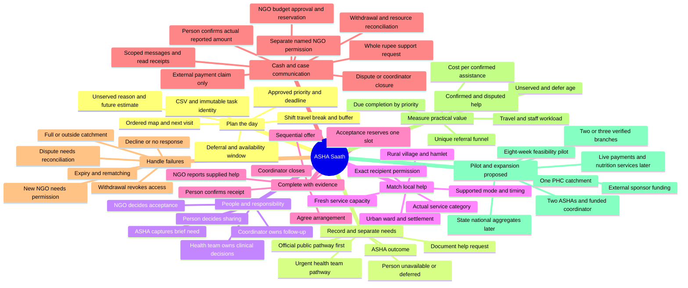

# Mind map and NGO operating model

Prepared 9 October 2026. Blue/implemented means the synthetic local prototype. Pilot/future means a proposal requiring participating people, approved rules, agreements and budget. See [visual mind map](ASHA_SAATH_MIND_MAP.svg).

## Complete product mind map

## Who connects to whom

```mermaid
flowchart LR
  H[Health supervisor] -->|approved tasks and priorities| P[Coordinator day plan]
  P -->|feasible order and unserved reasons| A[ASHA visit]
  A -->|urgent clinical need| C[Approved health facility pathway]
  A -->|nonclinical need| U[Public scheme or service pathway]
  U -->|access help still needed| Q[Coordinator]
  Q -->|category catchment capacity| N[Selected NGO service offer]
  N --> R[Person reviews exact recipient and fields]
  R -->|permission| O[Offer to that NGO]
  O -->|accept and reserve| B[NGO arrangement and supplied help]
  B -->|provider report| F[Person or assisted worker confirms]
  F -->|confirmed| Z[Coordinator closes]
  Q -->|separate person permission| K[Cash support request]
  K -->|NGO approval reserves budget| V[NGO records external payment claim]
  V -->|independent person receipt| F
  K -->|current case discussion| M[Scoped in-app messages and read receipts]
  O -->|declined or expired| Q
  F -->|partial or disputed| Q
  R -->|refuse or withdraw| W[Stop sharing and keep health visits independent]
  S[Sponsor and programme operator — proposed] -.->|agreed operating grant| Q
  S -.->|approved external resources| N
  Z -.->|permitted aggregates only| S
```

Beneficiaries do not need a new smartphone login in the prototype. ASHA records the fictional person's decision/outcome. A live pilot requires an approved assisted-consent and verification process; the demo is not evidence of production identity assurance.

## NGO partner lifecycle — proposed real operation

| Stage | What must be confirmed | Who is responsible |
|---|---|---|
| 1. Find local candidates | NGOs already delivering the chosen category in the pilot villages/wards; directory listings are leads | Programme operator and coordinator |
| 2. Check identity | Registration record, responsible organization/branch contact and local references; Darpan when relevant | Designated partner reviewer |
| 3. Verify the actual service | Type of help, exclusions, any fees, language, accessibility, hours, complaint route and one test referral | Reviewer plus branch delivery lead |
| 4. Agree participation | Scope, information handling, responsibilities, response targets and exit/pause arrangements | Programme operator and NGO |
| 5. Publish an offer | Exact catchment, allowed method/time, dated slots and refresh/expiry; office location kept separate | NGO branch |
| 6. Send a consented request | Public pathway considered first; person is told exact NGO and fields | Coordinator and ASHA/person |
| 7. Accept or decline | Confirm real capacity; acceptance reserves in the server transaction | NGO intake staff |
| 8. Arrange and supply | Agreed appointment/method; help actually provided or failure explained | NGO delivery staff and coordinator |
| 9. Confirm independently | Person confirms received/partial/not received; disputes remain visible | Person with authorized assisted recorder |
| 10. Review quality | Stale capacity, repeated failed help, complaints and workload; pause unsuitable offers | Programme operator/supervisor |

Darpan ID is not “NITI-approved NGO” status. Organization identity, service verification, catchment, available capacity and delivery are separate facts. [Official Darpan advisory](https://ngodarpan.gov.in/).

Do not onboard “all NGOs” at once. An inactive directory of hundreds of names cannot supply an appointment. Begin with a few branches that agree to receive and fulfil the actual category.

## A concrete example using the existing demo

1. Coordinator plans the rural worker's visits. Priority/deadline obligation precedes distance.
2. The fictional Visit 004 in Village B is completed; document-navigation help is requested.
3. Outreach A lists Village B as its service area. Its office may be elsewhere; office distance is not the eligibility rule.
4. Person agrees to share only request reference, help category, locality and preferred mode/time with Outreach A. No name, phone, clinical record or coordinates are sent to the NGO.
5. Coordinator sends one offer. Outreach A accepts; two available slots become one in the isolated initial demonstration.
6. NGO records an allowed in-person arrangement and reports document guidance.
7. Worker records the person's confirmation. Coordinator closes the document-help need. This does not mean a government benefit was sanctioned or a health condition resolved.

If another NGO is selected, new appropriate recipient permission is required. If no suitable offer exists, record that failure with an owner and next action rather than show a fake successful match.

## Response targets and failure recovery

The current synthetic app uses a 60-minute offer expiry to make expiry demonstrable. This is **not** a government norm or recommended universal NGO SLA.

In the pilot, negotiate targets with the service branch. Illustrative proposal: accept/decline within two working days; arrange an appointment within seven working days. Faster/slower services need different targets. Coordinator checks expiry, gets a reason, finds alternatives or reports the unmet need. Urgent health actions follow the approved health pathway immediately and do not wait for this timetable.

## Funding without an imaginary wallet

**Current build:** document guidance plus a synthetic NGO cash-assistance ledger and saved case conversations. A worker/coordinator selects an existing need, an NGO serving that locality, a whole-rupee amount and nonclinical purpose. The person gives separate permission naming that NGO. The NGO can approve within its own declared available budget or decline with a reason. Approval reserves the amount in a database transaction.

The NGO then records a fictional external payment reference. A worker/coordinator records the amount the person says they received independently; a mismatch is disputed. Only the coordinator closes a positively confirmed request. Withdrawal revokes provider access. If a payment has already been reported, the amount remains held until restricted reconciliation records verified use. Reconciliation does not restore permission or replace person confirmation. See [funding and communication contract](../FUNDING_AND_COMMUNICATION.md).

For example, a fictional ₹500 request for travel to the document service desk is an access-support scenario, not a government benefit or a verified NGO grant. Demo NGO A's ₹25,000 budget is fictional. The app does not move money, collect donations, keep bank/UPI details or verify a real payment. Approval, payment report and person receipt are different facts.

**Communication now implemented:** an authorized document-referral or funding case has its own thread for the assigned worker, coordinator and current NGO. Messages and read receipts persist; read status does not prove action or service completion. The NGO loses access when the relevant permission ends. There is no email, SMS, WhatsApp, public inbox or cold outreach.

**Proposed pilot:** an agreed domestic sponsor grant goes to the programme operator for coordinator time, verification, training, connectivity, field validation and technical support. NGOs use existing programme capacity or separately agreed externally funded slots. Agreements and settlements remain with the participating organizations. The software reports permitted aggregates and service confirmation; donor intent is not treated as cash received or help delivered.

**Later real operation:** participating organizations must agree actual grants/budgets, approved purposes, identity and receipt verification, grievance handling and accounting responsibilities. If a payment integration is added, it needs provider verification and reconciliation against actual external transactions. Broader in-kind transport/nutrition services need their own eligibility and delivery rules; the existing demo ledger does not establish them.

No household referral commission is proposed. A future programme contract or organizational subscription can cover software/support; no revenue or funding commitment is established. If CSR or cross-border funds are chosen, current implementing-agency/funding requirements must be independently checked for that specific arrangement before proceeding.

## Rural → urban → district → state → national

- **Rural:** per village/hamlet offers and assigned ASHA catchment; difficult-to-reach due work visible.
- **Urban:** ward/settlement offers and actual delivery method; office address alone insufficient.
- **District pilot:** coordinator and backup, partner review, operational grievance route, field validation.
- **State/national proposal:** approved aggregate reporting and federated local partnerships after successful pilots; no central public household-pin or medical-record map. Current demo has no real state/national partner coverage.

Expansion adds services only after eligibility, delivery responsibility, safety, capacity and confirmation rules are defined. Transport and nutrition offers may require different partners and clinical coordination; reusing a document-help form is insufficient.
